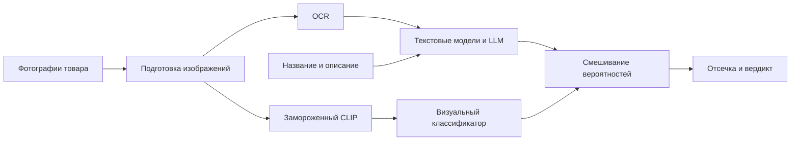

# E-CUP 2026: Проверка карточек по фотографиям и тексту

Решение вошло в **топ-25 лидерборда** задачи «Контроль качества» E-CUP 2026.

Решение [задачи «Контроль качества»](https://ods.ai/competitions/e-cup-2026-quality) от Ozon Tech и ODS. По карточке товара нужно определить, относится ли он к БАД или легковоспламеняющимся товарам, и вернуть вердикт с коротким комментарием.

В проекте сочетаются компьютерное зрение и обработка текста. Визуальная часть извлекает признаки фотографий через замороженный [CLIP ViT-B/32](https://huggingface.co/openai/clip-vit-base-patch32) и обучает на них классификаторы товаров. OCR через Tesseract отдельно читает надписи на упаковке.

Название, описание и распознанный текст обрабатываются TF-IDF моделями и замороженными Gemma и Qwen. Для двух категорий используются разные схемы классификации. Вероятности визуального и текстового каналов объединяются перед итоговым вердиктом.

| Часть решения | Что делает |
|---|---|
| Визуальная классификация | CLIP извлекает признаки фото, логистическая регрессия обучается на метках товаров |
| OCR | Читает русские и английские надписи и объединяет текст с нескольких фотографий |
| Текстовые модели и LLM | Оценивают название, описание и OCR с учётом похожих размеченных товаров |

## Результаты

| Public | Private |
|---|---|
| 0.8227538543 | 0.8357356339 |

Результаты получены для решения с OCR и визуальными классификаторами на признаках CLIP. Метрика считается как среднее F1 по двум категориям.

## Как устроено решение



### Подготовка фотографий

Фотографии объединяются по ID товара, до пяти кадров на карточку. Учитывается EXIF-ориентация, изображение переводится в RGB и уменьшается до 1600 пикселей по длинной стороне с сохранением пропорций. Повреждённые фото пропускаются. Ограничения составляют 30 МБ на файл и 25 миллионов пикселей.

### Визуальный классификатор

Модуль `submit/vision.py` извлекает через CLIP вектор из 512 признаков для каждой фотографии. Веса CLIP заморожены. Названия, описания и OCR на этом этапе не используются.

Векторы отдельных фото нормализуются, усредняются и снова нормализуются. Получается один вектор на товар. Одинаковые изображения внутри карточки учитываются один раз.

Поверх этих признаков обучается логистическая регрессия с балансировкой классов. Для БАД и легковоспламеняющихся товаров используются отдельные классификаторы. Обучение идёт только на метках трейна и товарах с доступными фотографиями. Для каждой категории нужны хотя бы два товара каждого класса.

Признаки фотографий сохраняются в `submit/.vision-cache`. Кэш привязан к содержимому изображения, весам CLIP и настройкам обработки. Готовые признаки трейна хранятся в `train_vision.npz`, а классификаторы обучаются при каждом запуске на актуальных метках `train_data.csv`. После извлечения признаков CLIP освобождается перед загрузкой LLM.

CLIP оценивает изображение целиком. Отдельной детекции этикеток, предметов или значков опасности в решении нет.

### Текст на фотографиях

Tesseract распознаёт русские и английские надписи на упаковке. Слова собираются в строки. Строки со средней уверенностью ниже 35 отбрасываются целиком, чтобы не потерять отдельные «не» и «без». Повторяющиеся строки на разных фотографиях объединяются. Для карточки сохраняется до 2000 символов текста.

Кэш OCR учитывает содержимое картинки, языковые веса и настройки распознавания. Подготовленный текст трейна сохраняется в `train_ocr.csv`, поэтому обучающие фотографии не нужно передавать в контейнер.

### Название, описание и LLM

Из названий и описаний удаляются HTML-теги, скрипты и стили. HTML-сущности преобразуются в символы, лишние пробелы убираются, пустые значения заменяются пустой строкой.

Для БАД используются словесные и символьные TF-IDF признаки, NB-взвешивание и логистическая регрессия. Для легковоспламеняющихся товаров работают два текстовых классификатора и замороженные `gemma-4-E4B-it` и `Qwen3.5-4B`.

OCR добавляется к признакам линейных моделей только для категорий, где он есть и в трейне, и в тесте. LLM получают его отдельным блоком, до 800 символов на товар. При отсутствии OCR трейна распознанный текст теста может использоваться только в LLM.

Примеры для LLM ищутся по символьному TF-IDF. Сначала выбираются товары той же подкатегории, затем остальные соседи. В промпт попадает до 4 или 8 примеров каждого класса и не больше одной карточки из группы почти-дублей. Для подкатегории «Прочее» поиск идёт по всему трейну. У Qwen есть дополнительный проход с фиксированными примерами. Оценка LLM берётся из логитов ответов «да» и «нет».

### Объединение предсказаний

Сигналы ЛВ объединяются логистическим стеком из `submit/params.json`. Затем к вероятностям основной модели каждой категории добавляется ответ визуального классификатора:

```text
p = (1 - vision_weight) * p_main + vision_weight * p_visual
```

По умолчанию `vision_weight = 0.2`. Это начальная настройка, она не подбиралась по метрике. Для товаров без визуального предсказания остаётся вероятность основной модели.

После смешивания карточки БАД сортируются по вероятности. Верхние `578 / 921`, примерно 62,8%, получают положительную метку. Для ЛВ число положительных ответов выбирается по максимуму ожидаемого F1.

### Комментарии и совпадения с трейном

В комментарий добавляется короткая цитата из названия или описания. Если подходящего фрагмента там нет, проверяется OCR, который участвовал в предсказании. Такая цитата помечается как «Распознано на фото (OCR)». Соседние слова сохраняются, чтобы было видно, например, «без газа в комплекте».

Если в решении участвовал визуальный классификатор, это тоже отмечается в комментарии. Конкретные найденные предметы не перечисляются, поскольку CLIP возвращает общие признаки изображения. Цитата из текста помогает проверить контекст, но не показывает вклад фразы в предсказание.

Для точных совпадений названия и описания с трейном используется метка большинства дублей, но только если в предсказании не участвовали OCR и визуальный классификатор. При равенстве голосов остаётся ответ модели.

## Файлы

```text
Dockerfile                 # окружение для решения
ocr.local.example.json     # пример локальных путей
submit/
  run.py                   # обучение, смешивание и предсказание
  ocr.py                   # распознавание текста на фотографиях
  vision.py                # CLIP и визуальные классификаторы
  prompts.py               # инструкции для LLM
  params.json              # коэффициенты стека
  fewshot_submit.json      # фиксированные примеры
  lv_groups.json           # группы почти-дублей
  train_data.csv           # обучающие данные
  metadata.json            # имя образа и команда запуска
tests/
  test_ocr.py               # проверки OCR
  test_vision.py            # проверки визуального канала
```

Файлы `submit/train_ocr.csv`, `submit/train_vision.npz` и папка `submit/clip_model` подготовлены. Полный архив обучающих фотографий в отправку не входит. Команды ниже позволяют повторить подготовку.

## Подготовленные данные

В обучающем CSV 12 971 товар. В доступном наборе фотографий есть 4 314 товаров, всего 16 485 изображений. Все эти фотографии обработаны.

| Данные | Число товаров |
|---|---|
| Доступны фотографии | 4 314 |
| Получен непустой текст OCR | 4 212 |
| Подготовлены признаки CLIP | 4 314 |
| Фотографий нет в доступном наборе | 8 657 |

Готовые CSV и NPZ содержат все обучающие ID. Для товаров без фото сохраняется отсутствие визуальных данных. У 102 товаров с фотографиями OCR не выделил текста, но признаки CLIP для них есть.

Состав набора, покрытие по категориям и контрольные суммы записаны в [preparation_report.json](preparation_report.json). Архив `submission.zip` собран с кодом, готовыми данными и весами CLIP.

## Подготовка OCR трейна

Нужны Pillow, Tesseract и языковые данные `rus` и `eng`. Список установленных языков можно проверить командой `tesseract --list-langs`.

Фотографии должны лежать в папках с ID товаров:

```text
images/
  34/
    0.jpg
    1.jpg
  60/
    0.jpg
```

Распознать доступные фотографии трейна:

```bash
python submit/ocr.py --data-path submit/train_data.csv \
  --images-path /path/to/train/images \
  --output-path submit/train_ocr.csv
```

Команда работает без общего ограничения времени. Кэш сохраняется в `submit/.ocr-cache`. В CSV записываются столбцы `id` и `ocr_text`. Для своей папки языковых весов добавьте `--tessdata-dir /path/to/tessdata`.

## Подготовка CLIP

Веса нужно скачать заранее на машине с интернетом:

```bash
python - <<'PY'
from huggingface_hub import snapshot_download
snapshot_download(
    "openai/clip-vit-base-patch32",
    local_dir="submit/clip_model",
    allow_patterns=["config.json", "preprocessor_config.json", "pytorch_model.bin", "README.md"],
)
PY
```

Для визуального канала нужны `torch`, `transformers` и Pillow. В контейнере веса загружаются только с диска, интернет при запуске не используется.

Подготовить признаки трейна:

```bash
python submit/vision.py --data-path submit/train_data.csv \
  --images-path /path/to/train/images \
  --model-path submit/clip_model \
  --output-path submit/train_vision.npz
```

Подготовка идёт без общего дедлайна. В NPZ хранятся ID товаров, признаки, маска доступных фото и подпись модели. При загрузке проверяется соответствие весам CLIP, строки сопоставляются по ID. Метки и предсказания теста в этот файл не записываются. Для чтения не используется pickle.

Путь к CLIP можно задать через `--clip-model-path`, переменную `CLIP_MODEL_PATH` или поле `clip_model_path` в `ocr.local.json`. Без явного пути проверяются `submit/clip_model` и `/shared_models/openai/clip-vit-base-patch32`.

Локальные пути к фотографиям и весам можно записать в `ocr.local.json` по образцу `ocr.local.example.json`. Этот файл, фотографии, веса и кэши в Git не включаются.

## Запуск

Из корня репозитория:

```bash
python submit/run.py -i test.csv -o submit.csv \
  --images-path /path/to/test/images \
  --clip-model-path submit/clip_model \
  --ocr required \
  --vision required
```

Поддерживаются длинные аргументы `--test_data_path` и `--output_path`. Входной CSV должен содержать `id`, `name`, `description`, `category`. Значения категории записываются как `БАД` или `Легковоспламеняющиеся`.

Скрипт автоматически читает `submit/train_ocr.csv` и `submit/train_vision.npz`. Другие пути задаются через `--train-ocr-path` и `--train-vision-path`. Если готовых данных нет, папку фото трейна можно указать через `--train-images-path` или переменную `TRAIN_IMAGES_PATH`.

Фото теста ищутся в папке `images` рядом с CSV. Явный путь задаётся через `--images-path` или переменную `IMAGES_PATH`. Фотографии трейна и теста указываются отдельно.

### Настройки визуального канала

- `--vision auto` включён по умолчанию. При недоступных весах, фото или недостатке обучающих примеров соответствующие визуальные предсказания пропускаются с сообщением в логе.
- `--vision required` завершает запуск с ошибкой, если не удалось получить ни одного визуального предсказания.
- `--vision-device auto` выбирает CUDA, затем MPS, затем CPU. Устройство можно задать явно.
- `--vision-batch-size 8` задаёт число фотографий в батче.
- `--vision-time-budget 30` задаёт время извлечения признаков отдельно для трейна и теста. Значение `0` снимает общий лимит. Уже подготовленный батч завершается, поэтому это не жёсткий предел времени процесса.
- `--vision-weight 0.2` задаёт долю визуальной вероятности в смеси.

Для проверки подключения можно добавить `--diagnostics-path diagnostics.csv`. Отдельный файл содержит вероятность CLIP и признаки использования OCR и визуального канала для каждого тестового товара. Формат конкурсного `submit.csv` не меняется.

### OCR и LLM

По умолчанию действует `--ocr auto`. Если фото или OCR недоступны, используются доступные данные. Режим `--ocr required` завершает запуск с ошибкой, если OCR недоступен или не получил текст ни для одной тестовой карточки.

OCR получает до 60 секунд на тест и ещё до 60 секунд на трейн, если готового `train_ocr.csv` нет. На фотографию отведено до 8 секунд. По умолчанию одновременно работают четыре задачи. Лимиты меняются через `--ocr-time-budget` и `--ocr-workers`, значение `0` снимает общий дедлайн.

Для текстовой части нужны `numpy`, `pandas`, `scipy` и `scikit-learn`. Для LLM дополнительно нужны совместимые версии `torch`, `transformers`, `accelerate` и GPU с CUDA. Веса ищутся в каталогах:

```text
/shared_models/google/gemma-4-E4B-it
/shared_models/Qwen/Qwen3.5-4B
```

Корень меняется через `SHARED_MODELS_PATH`. Для запуска без интернета веса нужно разместить заранее. Если их нет локально, код попробует загрузить LLM по идентификатору Hugging Face.

Время LLM отсчитывается от начала всего запуска, включая OCR и CLIP. Gemma работает до 9-й минуты, Qwen до 16-й. Незавершённые проходы отбрасываются, стек выбирается по доступным сигналам. Без CUDA остаются линейные модели, OCR и визуальный классификатор, если для них есть нужные данные.

## Формат ответа

На выходе получается CSV со столбцами `id` и `result`:

```text
<комментарий>Решение принято по текстовым признакам названия и описания товара.<вердикт>не бан
```

Вердикт может быть только `бан` или `не бан`. Комментарий занимает от 50 до 300 символов. Закрывающих тегов нет. Метка `1` соответствует `не бан`, метка `0` соответствует `бан`.

## Контейнер и отправка

Dockerfile собирает окружение с Tesseract, Pillow и русскими и английскими языковыми данными. Имя для сборки `artemmelikhov/ecup-quality-ocr:1.0` указано в `submit/metadata.json`.

```bash
docker build -t artemmelikhov/ecup-quality-ocr:1.0 .
docker push artemmelikhov/ecup-quality-ocr:1.0
```

Если логин Docker Hub другой, замените имя в командах и поле `image` в `metadata.json`. Перед отправкой образ должен быть опубликован и доступен проверяющей системе.

После подготовки OCR, признаков и весов архив собирается из корня репозитория:

```bash
(cd submit && zip -r ../submission.zip \
  run.py ocr.py vision.py prompts.py params.json fewshot_submit.json \
  lv_groups.json train_data.csv train_ocr.csv train_vision.npz \
  metadata.json clip_model -x "*/.cache/*" "*/.git/*")
```

Код, CSV, NPZ и `metadata.json` должны лежать в корне ZIP, веса CLIP в папке `clip_model/`. CLIP не предполагается предустановленным в проверяющей системе, поэтому его веса включаются в архив. На проверку отправляется ZIP, Docker-образ скачивается по имени из `metadata.json`.

## Проверки

```bash
python -m unittest discover -s tests -v
```

Проверяются ошибки чтения фото, EXIF-ориентация, кэш, объединение нескольких изображений, привязка признаков к ID, обучение визуального классификатора и влияние его вероятностей на выходной CSV. Метрики качества в этих тестах не считаются.

Seed зафиксирован на `42`. На предсказания влияют состав входного набора, покрытие фотографиями, доступность моделей и время обработки.
